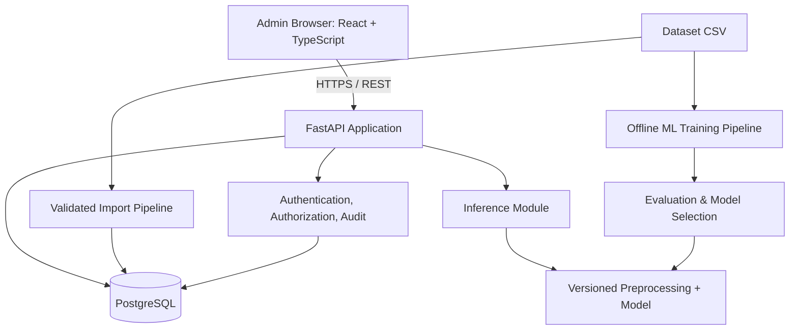

# CyberSecurity: AI-Powered Cyber Threat Analytics Dashboard

**Document type:** Software Requirements Specification (SRS) and Technical Design  
**Project name:** CyberSecurity  
**Version:** 1.0 (Proposed)  
**Date:** 2026-10-08  
**Status:** Draft for implementation

---

## 1. Executive Summary

CyberSecurity is a web-based administrative dashboard for exploring network traffic records, analyzing potential cyber threats, classifying attack types with machine learning, and managing security alerts.

The initial prototype will use the `cybersecurity_attacks` dataset described in the supplied README. The README states that the dataset contains **40,000 records and 25 fields**. It lists column names but does **not** provide the actual CSV, a data dictionary, label distributions, missing-value statistics, verified timestamps, or evidence of benign (non-attack) records. These unknowns must be resolved during initial data profiling.

The system will combine:

- **Machine learning:** Python, pandas, scikit-learn, and XGBoost.
- **Backend:** FastAPI, Pydantic, SQLAlchemy, and Alembic.
- **Frontend:** React, TypeScript, Vite, Tailwind CSS, shadcn/ui, and Apache ECharts.
- **Database:** PostgreSQL.
- **Deployment:** Docker and Docker Compose.

**Critical distinction:** Classifying an observed network record, detecting an anomaly, and forecasting an attack in the future are three different tasks. The MVP implements historical analytics and attack-type classification, subject to data validation. Binary attack detection is supported only if trustworthy attack-versus-benign labels exist. Future attack forecasting is an explicitly deferred research feature.

## 2. Project Goals

### 2.1 Primary objectives

1. Provide a secure administrative interface for viewing and filtering network traffic data.
2. Display descriptive statistics and interactive visualizations of security events.
3. Build, evaluate, and compare supervised machine-learning models for **attack-type classification**, provided `Attack Type` contains usable classes.
4. Offer a REST endpoint for model inference on new, appropriately structured network records.
5. Store historical predictions, model versions, security alerts, and audit logs.
6. Explain model performance using reproducible metrics, error analysis, and feature attribution where appropriate.
7. Package the complete application for repeatable local development and demonstration.

### 2.2 Secondary objectives

- Detect unusual records with an unsupervised anomaly-detection model.
- Support configurable alert thresholds and human review of predictions.
- Export filtered summaries and reports.
- Establish an architecture that can later integrate real IDS/IPS or firewall telemetry.

### 2.3 Non-goals for the MVP

- Autonomous intrusion prevention, firewall rule changes, or blocking IP addresses.
- Guaranteed real-time detection from a static CSV file.
- Forecasting attacks one hour or one day ahead without constructing a valid temporal target.
- Claims of production-ready accuracy solely from one public dataset.
- Large-scale SIEM functionality, distributed streaming, or automatic incident remediation.

## 3. Users and Access Control

| Role | MVP status | Permissions |
|---|---|---|
| Administrator | Required | Sign in; import data; view analytics; run predictions; manage alerts; inspect model reports and audit history. |
| Read-only Analyst | Optional | View traffic, dashboards, alerts, and model reports without importing or modifying data. |

The MVP may start with a single seeded administrator and a role field that supports future extension. Authentication and authorization are enforced by the backend, not only by frontend route guards.

## 4. Dataset Specification

### 4.1 Source

- **Dataset name:** `cybersecurity_attacks`
- **Declared size:** 40,000 records
- **Declared schema:** 25 fields
- **Source of this description:** User-provided `README(3).md`
- **Raw data availability at specification time:** Not provided; only the field-name README is available.

### 4.2 Original columns

The exact field names in the supplied README are:

| # | Original column | Category | Intended treatment |
|---:|---|---|---|
| 1 | `Timestamp` | Time | Parse to timezone-aware timestamp; inspect chronology. |
| 2 | `Source IP Address` | Network | Validate and normalize; derive safe network features. |
| 3 | `Destination IP Address` | Network | Validate and normalize; derive safe network features. |
| 4 | `Source Port` | Network | Validate valid integer range. |
| 5 | `Destination Port` | Network | Validate valid integer range. |
| 6 | `Protocol` | Traffic | Categorical feature; normalize casing and unknown values. |
| 7 | `Packet Length` | Traffic | Numeric feature; validate units and nonnegative values. |
| 8 | `Packet Type` | Traffic | Categorical feature. |
| 9 | `Traffic Type` | Traffic | Categorical feature; verify whether it encodes the label. |
| 10 | `Payload Data` | Content | Sensitive, potentially large text; excluded from initial ML feature set pending analysis. |
| 11 | `Malware Indicators` | Security signal | Check observation time and possible target leakage before inclusion. |
| 12 | `Anomaly Scores` | Security signal | Check how the score was generated and whether it leaks labels. |
| 13 | `Alerts/Warnings` | Security signal | Treat as possibly post-detection; exclude until verified. |
| 14 | `Attack Type` | Candidate target | Multiclass target if labels are valid; inspect whether a benign class exists. |
| 15 | `Attack Signature` | Security signal | High leakage risk; exclude from primary baseline. |
| 16 | `Action Taken` | Response | Post-event field; do not use as a predictive feature. |
| 17 | `Severity Level` | Outcome/metadata | Display in dashboard; exclude from baseline ML features. |
| 18 | `User Information` | Context | Potentially sensitive; investigate format and minimize use. |
| 19 | `Device Information` | Context | Potential feature after schema and leakage review. |
| 20 | `Network Segment` | Context | Categorical feature if available at prediction time. |
| 21 | `Geo-location Data` | Context | Display carefully; avoid treating geolocation as proof of maliciousness. |
| 22 | `Proxy Information` | Context | May be encoded after format and availability are verified. |
| 23 | `Firewall Logs` | Security log | May reflect downstream decisions; initially exclude from ML. |
| 24 | `IDS/IPS Alerts` | Security log | Potentially downstream of detection; initially exclude from ML. |
| 25 | `Log Source` | Metadata | Useful for filtering and investigating source bias. |

The original CSV column names must be preserved at the ingestion boundary. The application may use normalized `snake_case` names internally, with an explicit mapping for reproducibility.

### 4.3 Required dataset profiling

Before modeling, generate a data-quality report containing:

- Actual row and column counts, data types, ranges, and sample records.
- Missing/null rates, duplicates, inconsistent values, and parse failures.
- Attack-type labels, class counts, class imbalance, and presence/absence of benign records.
- Timestamp span, ordering, time-zone assumptions, and repeated observations.
- Possible leakage and tautological relationships between predictors and `Attack Type`.
- Whether columns would be present **before** a security detection decision in a real deployment.
- Sensitive content and any restrictions on retaining payload, user, or IP information.
- Evidence that train/validation/test examples can be separated without correlated duplicates or shared-session leakage.

**Decision gate:** Do not finalize the ML target, feature list, or claims about detection accuracy until profiling is complete.

## 5. Functional Requirements

Priority labels: **P0** = required MVP, **P1** = enhancement, **P2** = future scope.

### 5.1 Authentication and administration

| ID | Priority | Requirement | Acceptance criterion |
|---|---|---|---|
| FR-01 | P0 | Admin login/logout | Unauthenticated users cannot access protected APIs or pages. |
| FR-02 | P0 | Backend-enforced authorization | Unauthorized roles receive HTTP 403. |
| FR-03 | P0 | Audit administrative actions | Login failures, imports, alert edits, and model activation actions are timestamped. |
| FR-04 | P1 | Analyst read-only access | Analyst cannot import data, change alerts, or switch models. |

### 5.2 Data ingestion and traffic exploration

| ID | Priority | Requirement | Acceptance criterion |
|---|---|---|---|
| FR-05 | P0 | Import a CSV containing the documented dataset columns | File is validated; import count and rejected-row count are displayed. |
| FR-06 | P0 | Paginated traffic table | Users can sort, filter by time/IP/protocol/type/severity, and inspect a record. |
| FR-07 | P0 | Data quality summary | UI displays missing values, invalid rows, duplicates, and label distribution. |
| FR-08 | P0 | Search and date filtering | Applying filters changes table results and visualizations consistently. |
| FR-09 | P1 | Export filtered data or a report | Output respects permissions and safely escapes spreadsheet-formula-like content. |

### 5.3 Dashboard and analytics

| ID | Priority | Requirement | Acceptance criterion |
|---|---|---|---|
| FR-10 | P0 | KPI summary cards | Total records, categorized events, time span, and available alert counts are displayed. |
| FR-11 | P0 | Time-series chart | Shows record counts and labeled attack counts over selectable time buckets. |
| FR-12 | P0 | Attack distribution chart | Shows counts per `Attack Type`, with an explicit unknown/unlabeled category when needed. |
| FR-13 | P0 | Network analytics | Top source/destination IPs, protocols, ports, and traffic categories can be viewed. |
| FR-14 | P1 | Severity and geography charts | Display only fields that can be interpreted reliably. |
| FR-15 | P1 | Dashboard refresh | Polls for new ingested records without requiring a full page reload. |

Dashboard cards must clearly identify whether a value is sourced from **ground-truth dataset labels**, **model predictions**, or **human-confirmed incidents**. They must not mix these categories without a legend.

### 5.4 Machine-learning predictions

| ID | Priority | Requirement | Acceptance criterion |
|---|---|---|---|
| FR-16 | P0 | Attack-type classification | API returns the predicted class, model version, and available class scores for a valid input. |
| FR-17 | P0 | Model performance page | Displays confusion matrix, per-class precision/recall/F1, macro-F1, and test-set provenance. |
| FR-18 | P0 | Persist prediction history | Each prediction is associated with timestamp, model version, and source record or request. |
| FR-19 | P0 | Reproducible preprocessing | Training and inference load the same saved preprocessing pipeline. |
| FR-20 | P1 | Binary attack-vs-benign detection | Enabled only if verified benign/attack labels exist. |
| FR-21 | P1 | Unsupervised anomaly scoring | Flag atypical records with an explicit disclaimer that anomaly != attack. |
| FR-22 | P1 | Model explanation | Provide supported feature attribution for selected predictions and global reports. |
| FR-23 | P2 | Future-window attack forecasting | Enabled only after constructing and validating temporal forecasting targets. |

### 5.5 Alerts and investigation

| ID | Priority | Requirement | Acceptance criterion |
|---|---|---|---|
| FR-24 | P0 | Alert list and details | Shows source, timestamp, reason, score, model version, and status. |
| FR-25 | P0 | Manual alert workflow | Admin can change `new` -> `investigating` -> `resolved` / `dismissed`; action is audited. |
| FR-26 | P1 | Configurable alert thresholds | Changing a threshold affects only newly evaluated events unless reprocessing is explicitly requested. |
| FR-27 | P1 | Investigative notes | Admin can store review notes with timestamps. |

For multiclass-only models, alerts must not be triggered by simply treating the highest class probability as the probability that an attack is occurring. Alerts may instead use a validated binary detector, an anomaly model with a separately chosen threshold, or clearly designated dataset-derived rule conditions.

## 6. Product Pages and UI Design

### 6.1 Main navigation

1. **Login** — secured administrator authentication.
2. **Overview** — KPI cards, time-series trends, recent alerts, attack distribution.
3. **Traffic Explorer** — searchable, paginated event table and detail panel.
4. **Threat Analytics** — types, severity, source/destination patterns, protocols, optional map.
5. **Prediction Lab** — manual input or selection of a record, model prediction, explanations.
6. **Alerts** — triage queue, alert detail, status changes, review notes.
7. **Model Evaluation** — model comparison, confusion matrix, per-class metrics, selected version.
8. **Dataset Management** — CSV import and validation status.
9. **Settings / Audit** — profile, thresholds, audit trail (subject to role).

### 6.2 Design expectations

- Responsive desktop-first admin layout; mobile remains usable for inspection.
- Light/dark mode optional; avoid color alone as an alert severity indicator.
- All charts include titles, units, data-source labels, time windows, and empty/loading/error states.
- Filters persist while navigating related tables/charts where feasible.
- Use server-side filtering, pagination, and sorting rather than sending the full dataset to the browser.
- Mask or truncate sensitive payloads, usernames, and IP information according to configured access policy.

## 7. Proposed Technology Stack

| Layer | Technology | Responsibility |
|---|---|---|
| Model training | Python 3, pandas, NumPy | Profiling, preprocessing, feature engineering. |
| ML models | scikit-learn, XGBoost | Baselines and primary classification model. |
| Model analysis | scikit-learn metrics, SHAP (optional) | Evaluation, feature attribution. |
| Backend | FastAPI, Pydantic | API, input validation, inference orchestration. |
| Data access | SQLAlchemy, Alembic | Database models, queries, schema migrations. |
| Frontend | React, TypeScript, Vite | Single-page admin dashboard. |
| Styling | Tailwind CSS, shadcn/ui | Consistent UI components. |
| Server state | TanStack Query | API caching and refresh. |
| Charts | Apache ECharts | Time series, distributions, heatmaps. |
| Relational storage | PostgreSQL | Events, prediction outputs, alerts, users, audit logs. |
| Authentication | Secure server-side session or JWT with secure cookie strategy | Protected API access. |
| Dev / deployment | Docker, Docker Compose | Reproducible environments. |
| Automated tests | pytest, Vitest, Playwright | Backend, frontend, end-to-end verification. |

**Default architecture:** One FastAPI service that loads a trusted model artifact, one React frontend, and one PostgreSQL database. Separate model-serving and streaming services are not necessary for the MVP.

## 8. System Architecture



### 8.1 Core backend modules

- `auth`: login, sessions/tokens, access control.
- `datasets`: CSV upload, schema checks, batch ingestion, data-quality statistics.
- `traffic`: paginated filtering, event details, aggregation queries.
- `analytics`: KPI calculations and chart-ready aggregates.
- `ml`: trusted model loading, input validation, inference, version metadata.
- `alerts`: rule/model-derived alerts and human review workflow.
- `models`: experiment results and active model metadata.
- `audit`: write-only audit recording for sensitive actions.

### 8.2 Offline versus online processing

**Offline:** Import CSV, explore data, train/evaluate models, activate a versioned model artifact.  
**Online (MVP):** Receive a structured prediction request, perform identical preprocessing, run inference, store the result, optionally create a justified alert.  
**Future:** Collect network events from a validated source such as an IDS/IPS, firewall, or telemetry agent. This is not included in the static-CSV MVP.

## 9. Machine Learning Specification

### 9.1 Problem definitions

**Task A — Multiclass classification (MVP, conditional on valid labels)**  
Predict `Attack Type` using features available at classification time.

\[
\hat{y} = \arg\max_{k \in K} P(Y=k\mid X=x)
\]

A class-probability vector describes how the model distributes probability among the **trained classes**, not the probability that a previously benign network will be attacked tomorrow.

**Task B — Binary detection (P1, conditional)**  
Predict attack versus benign only if the dataset contains a defensible negative class or an externally validated way to obtain negatives. Do not infer benign from missing attack information.

**Task C — Anomaly detection (P1)**  
Estimate unusualness from traffic features using Isolation Forest. Treat anomaly output as an anomaly score, not as ground-truth evidence of a cyberattack.

**Task D — Temporal forecasting (P2, separate study)**  
Define a time window `t`, aggregate strictly past observations, and predict whether a verified attack occurs in `(t, t + horizon]`. Requires reliable timestamps, time continuity, event labeling, and a time-based evaluation protocol. Merely renaming current-record classification as "prediction of future attacks" is prohibited.

### 9.2 Model candidates

| Model | Role | Why it is included |
|---|---|---|
| Majority-class / DummyClassifier | Sanity baseline | Detects whether the learned model meaningfully exceeds trivial guesses. |
| Logistic Regression | Interpretable baseline | Fast, transparent initial performance reference. |
| Random Forest | Nonlinear baseline | Captures interactions in tabular features. |
| XGBoost | Primary candidate | Strong candidate for structured tabular classification. |
| Isolation Forest | Optional anomaly model | Supports unsupervised unusualness detection. |

The best model must be selected from held-out validation results rather than assumed in advance.

### 9.3 Feature engineering

**Initial candidate predictors:** `Protocol`, `Packet Length`, `Packet Type`, `Source Port`, `Destination Port`, and other reviewed context columns such as `Network Segment`. `Traffic Type` must undergo leakage checks before inclusion.

**Potential derived features, if supported by observation granularity:**

- Port category (well-known, registered, dynamic).
- Source/destination private-versus-public IP classification.
- Hour of day and day of week (only when timestamps and time zones are valid).
- Connection count, unique destination count, and traffic frequency over a past-only rolling window **if multiple records form a meaningful timeline**.

**Initially excluded from predictive inputs:** `Attack Type` (target), `Action Taken`, `Severity Level`, `Attack Signature`, `Alerts/Warnings`, `IDS/IPS Alerts`, `Firewall Logs`, and `Payload Data`. `Malware Indicators`, `Anomaly Scores`, and other security-derived columns require additional verification before use.

- Split the data **before fitting** imputers, encoders, scalers, or feature-selection steps.
- Use scikit-learn `Pipeline` / `ColumnTransformer` to prevent preprocessing leakage.
- One-hot encode moderate-cardinality categories; avoid unbounded encoding of raw IPs or arbitrary strings.
- Document how unseen categories, malformed IPs, missing values, and unexpected data are handled.
- Remove exact duplicates and investigate near-duplicates across data splits.

### 9.4 Train / validation / test policy

**Default exploratory split:** 70% training / 15% validation / 15% testing with stratification where valid.

**Preferred split for chronological data:** Train on earlier periods, validate on later periods, and reserve the latest independent period for final testing. Where timestamps are unreliable, use justified grouping to prevent leakage between related events or traffic sessions.

- The test set must remain untouched during feature selection and hyperparameter tuning.
- Preprocessing is fitted on training data only.
- Tune XGBoost using a validation strategy appropriate for the observed data structure.
- Store random seeds, hyperparameters, data version, feature list, training code revision, and environment metadata.
- Perform a final single evaluation on the untouched test set.
- If the dataset does not support an independent evaluation protocol, state this limitation prominently.

### 9.5 Evaluation metrics

Required classification metrics:

\[
\mathrm{Precision}=\frac{TP}{TP+FP},\quad
\mathrm{Recall}=\frac{TP}{TP+FN},\quad
F_1=\frac{2PR}{P+R}
\]

- Per-class precision, recall, F1-score, and support.
- Macro-F1 and weighted-F1.
- Confusion matrix and normalized confusion matrix.
- Accuracy **only as a supplementary metric**, especially under imbalance.
- For verified binary labels: positive-class recall, false-positive rate, precision-recall curve, and PR-AUC.
- For probability-bearing output: calibration plot and Brier score or another suitable calibration measure.
- Inference latency and model artifact size as operational measures.

**Primary selection metric:** Macro-F1 for multiclass attack-type classification, with particular attention to low-recall minority classes. The primary metric may change only after profiling and must be recorded before final test evaluation.

### 9.6 Probability and alert thresholds

- If a model outputs class probabilities, evaluate whether probabilities require calibration.
- Display `confidence` only with a label clarifying it is conditional on the trained classes.
- Never label the highest multiclass score as "87% chance of being attacked" without a validated binary-risk target.
- If binary detection is available, choose thresholds on validation data and show recall/FPR trade-offs.
- Track threshold and model versions for every generated alert.

### 9.7 Model serialization and lifecycle

- Save the entire preprocessing-plus-model pipeline in a **trusted, versioned** artifact.
- Store artifact checksum, training metadata, feature schema, and evaluation metrics.
- Do not load untrusted pickle/joblib artifacts uploaded by users.
- At startup, load the configured active model and fail clearly if its schema/version is incompatible.
- Maintain a rollback path to the previously validated model.
- Retraining in the admin website is deferred; use a documented offline training command for the MVP.

## 10. Database Design

Use PostgreSQL with migration scripts and explicit indexes. The schema below is conceptual; refine field types after inspecting the actual CSV.

### 10.1 Tables

| Table | Key fields | Description |
|---|---|---|
| `users` | `id`, `email`, `password_hash`, `role`, `created_at` | Accounts and permissions. |
| `dataset_imports` | `id`, `filename`, `checksum`, `status`, `total_rows`, `accepted_rows`, `rejected_rows`, `created_at` | Import provenance and validation statistics. |
| `network_traffic` | `id`, `dataset_import_id`, `event_timestamp`, `source_ip`, `destination_ip`, `source_port`, `destination_port`, `protocol`, `packet_length`, `packet_type`, `traffic_type`, `attack_type`, `severity_level`, `metadata`, `created_at` | Normalized events with optional raw field storage subject to retention policy. |
| `model_versions` | `id`, `name`, `version`, `artifact_path`, `checksum`, `feature_schema`, `metrics`, `is_active`, `created_at` | Model metadata and selection history. |
| `predictions` | `id`, `traffic_id`, `model_version_id`, `predicted_class`, `class_scores`, `anomaly_score`, `created_at` | Inference results. |
| `security_alerts` | `id`, `traffic_id`, `prediction_id`, `rule_id`, `severity`, `status`, `reason`, `reviewed_by`, `reviewed_at`, `created_at` | Reviewable alert records. |
| `audit_logs` | `id`, `actor_id`, `action`, `entity_type`, `entity_id`, `details`, `created_at` | Administrative activity trace. |

### 10.2 Schema notes

- Use UUID or bigint primary keys consistently.
- Store structured optional metadata as validated `JSONB` where a fixed typed column is not yet justified.
- Prefer PostgreSQL `INET` type for parsed IP addresses when ingestion semantics permit.
- Store all event times in UTC and record the original assumed/source timezone if known.
- Index timestamp, source/destination IP, attack type, import ID, alert status, and prediction model ID according to query patterns.
- Large or sensitive `Payload Data` should be excluded from routine ingestion unless clearly necessary; do not expose raw payloads on default API responses.
- Add foreign keys, uniqueness constraints where appropriate, and a documented retention/deletion policy.
- Historical dataset labels and model predictions must live in separate columns/tables.

## 11. REST API Contract

**Base path:** `/api/v1`  
**Data format:** JSON except CSV uploads and report downloads.  
**Authentication:** Authenticated secure session or short-lived token carried via a secure cookie strategy; CSRF protections are required where cookie-based auth is used.

| Method | Endpoint | Description |
|---|---|---|
| `POST` | `/auth/login` | Authenticate an administrator. |
| `POST` | `/auth/logout` | End a session. |
| `GET` | `/auth/me` | Return current user and role. |
| `POST` | `/datasets/import` | Upload/validate/import a CSV. |
| `GET` | `/datasets/imports` | List import jobs and outcomes. |
| `GET` | `/datasets/quality` | Data-quality summaries. |
| `GET` | `/traffic` | Paginated and filtered traffic events. |
| `GET` | `/traffic/{id}` | Event details, excluding unsafe content by default. |
| `GET` | `/dashboard/summary` | KPI aggregates. |
| `GET` | `/dashboard/timeseries` | Time-bucketed event aggregates. |
| `GET` | `/dashboard/attack-types` | Label distribution. |
| `GET` | `/dashboard/network` | Top addresses, protocols, ports. |
| `POST` | `/predictions` | Classify a valid new observation. |
| `GET` | `/predictions` | Paginated prediction history. |
| `GET` | `/alerts` | List and filter alerts. |
| `GET` | `/alerts/{id}` | Alert details. |
| `PATCH` | `/alerts/{id}` | Update review status/notes. |
| `GET` | `/models` | List model versions and status. |
| `GET` | `/models/{id}/metrics` | Return saved evaluation results. |
| `GET` | `/audit-logs` | Administrator audit trail. |
| `GET` | `/health/live` | Process liveness. |
| `GET` | `/health/ready` | Database and active-model readiness. |

### 11.1 Example prediction request

The example shows an **illustrative feature subset**. The final accepted schema must be generated from the versioned training feature contract.

```http
POST /api/v1/predictions
Content-Type: application/json
```

```json
{
  "source_ip": "192.0.2.10",
  "destination_ip": "198.51.100.20",
  "source_port": 52124,
  "destination_port": 443,
  "protocol": "TCP",
  "packet_length": 840,
  "packet_type": "Data",
  "traffic_type": "HTTP"
}
```

### 11.2 Example response structure

Values below are **synthetic examples**, not verified performance or a prediction from the supplied dataset.

```json
{
  "prediction_id": "example-prediction-id",
  "task": "attack_type_classification",
  "model_version": "attack-type-xgb-v1",
  "predicted_class": "ExampleAttackClass",
  "class_probabilities": {
    "ExampleAttackClass": 0.72,
    "OtherClassA": 0.18,
    "OtherClassB": 0.10
  },
  "interpretation": "Probabilities are conditional on the trained attack-type classes, not future attack risk.",
  "created_at": "2026-10-08T12:00:00Z"
}
```

Unknown fields, invalid port ranges, non-finite numeric values, and incompatible feature schemas must yield helpful 4xx validation errors. Unexpected model/DB failures must not disclose sensitive internals.

### 11.3 Common API behavior

- Consistent pagination: `page`, `page_size`, `total`, `items`.
- Explicit UTC time filters: `start_time`, `end_time`.
- Standardized error body with machine-readable code and correlation ID.
- Stable OpenAPI contract generated from Pydantic schemas.
- Authorization, request size limits, and rate limits on sensitive or expensive endpoints.
- No arbitrary SQL query endpoint or execution of untrusted uploaded code/artifacts.

## 12. Security, Privacy, and Reliability

### 12.1 Application security

- Hash passwords with an established password-hashing algorithm such as Argon2id.
- Use TLS in deployed environments.
- Use secure, HttpOnly cookies where sessions/tokens are cookie-based, and enforce CSRF protection as appropriate.
- Validate every API input, including CSV dimensions, encodings, content type, and column names.
- Use parameterized SQL/ORM queries and least-privilege database credentials.
- Set restrictive CORS and Content Security Policy.
- Escape untrusted log and payload content in the UI to mitigate XSS.
- Prevent CSV formula injection in any export.
- Apply file-size limits and avoid saving arbitrary uploaded files in public web directories.
- Keep credentials in environment variables or a secret manager, never in source control.
- Log errors without storing passwords, tokens, or full sensitive payloads.
- Back up the database and document restore procedures.

### 12.2 Data minimization

IP addresses, user/device information, payloads, and security logs may reveal sensitive organizational or personal information. Limit collection and access; configure retention, redaction, and deletion. Use sample or synthetic records for public demonstrations where appropriate.

### 12.3 ML-specific security

- Restrict who can publish/activate models.
- Validate the expected feature schema and model checksum before loading artifacts.
- Keep uploaded datasets and model artifacts separate from application executables.
- Monitor dataset shift, low-confidence predictions, and failures in input validation.
- Require human review before operational security action; the MVP does **not** automate network blocking.

## 13. Non-Functional Requirements

| ID | Category | Target / requirement |
|---|---|---|
| NFR-01 | Usability | A new administrator can log in, import a valid CSV, inspect charts, and run a prediction without command-line interaction. |
| NFR-02 | Performance | Dashboard filtered queries should usually complete within 2 seconds for the 40,000-row prototype; benchmark on the chosen host. |
| NFR-03 | Inference | Target p95 single-record inference below 500 ms on the target deployment hardware, excluding initial model load; verify empirically. |
| NFR-04 | Scalability | Use server-side pagination and indexes; avoid browser-side loading of all records. |
| NFR-05 | Reproducibility | Re-running the training pipeline from the same data, configuration, and code revision produces comparable measurements. |
| NFR-06 | Observability | Expose structured logs, health endpoints, error counters, and request correlation IDs. |
| NFR-07 | Maintainability | Clear modules, typed API contracts, migration scripts, linting, and automated tests. |
| NFR-08 | Portability | Entire MVP can run locally using Docker Compose with documented setup commands. |
| NFR-09 | Accessibility | Keyboard-accessible navigation, useful chart text alternatives, and sufficient contrast. |
| NFR-10 | Privacy | Sensitive fields are minimized, masked by default, and access-controlled. |

Performance values above are **engineering targets**, not measurements from the README.

## 14. Testing and Verification

### 14.1 Data and ML tests

- Reject missing required CSV columns and malformed records.
- Confirm no target column or unapproved post-event features enter the training pipeline.
- Confirm imputation/encoding are learned from training samples only.
- Test chronological or grouped split integrity; detect duplicate leakage.
- Evaluate all baseline candidates using the same partitions and metrics.
- Compare inference output after saving/reloading the pipeline.
- Exercise missing fields, unseen categories, malformed IPs, and boundary port numbers.
- Verify probability vectors are valid if probabilistic output is exposed.
- Verify model version and feature schema are returned and stored with predictions.

### 14.2 Backend tests

- Authentication success/failure, authorization, session expiry.
- Import idempotency or duplicate-import policy, validation failures, and partial failures.
- Pagination, sorting, and each supported filter.
- Alert state transitions and audit-log creation.
- Error handling, invalid request rejection, and sensitive-data redaction.

### 14.3 Frontend and end-to-end tests

- Login to overview navigation.
- Import a small test CSV and observe updated counts.
- Filter traffic and confirm table/chart consistency.
- Predict a record and view its stored history.
- Change alert status and verify persistent audit history.
- Check empty/loading/error states and basic responsive layout.

### 14.4 Acceptance criteria for MVP release

The MVP is accepted when:

1. A reproducible local stack starts with a documented Docker Compose command.
2. A valid 25-column CSV can be imported with row counts and validation feedback.
3. Admin authentication and backend authorization pass security tests.
4. Overview and traffic explorer display correct, filterable data and sourced labels.
5. At least three supervised candidates (including a trivial baseline) are compared on a documented validation protocol, **if valid supervised labels exist**.
6. The selected model and its preprocessing pipeline are versioned and can serve repeatable predictions.
7. Model Evaluation clearly reports class-wise metrics and limitations.
8. Prediction histories and manual alert updates persist in PostgreSQL.
9. Automated tests cover major API endpoints and one complete user journey.
10. The documentation accurately distinguishes observed labels, model classes, anomaly scores, and future-event forecasts.

If label-quality assessment fails, the project must still deliver data analytics and ingestion, but the supervised classification feature cannot be marked as successful by inventing labels.

## 15. Suggested Repository Structure

```text
CyberSecurity/
├── README.md
├── CyberSecurity.md
├── .env.example
├── docker-compose.yml
├── backend/
│   ├── Dockerfile
│   ├── pyproject.toml
│   ├── alembic/
│   ├── app/
│   │   ├── main.py
│   │   ├── core/              # config, auth, security, logging
│   │   ├── api/v1/            # routes and request/response schemas
│   │   ├── db/                # models, session, migrations helpers
│   │   ├── services/          # import, analytics, alerts, inference
│   │   └── ml/                # trusted model loader and feature contract
│   └── tests/
├── frontend/
│   ├── Dockerfile
│   ├── package.json
│   └── src/
│       ├── app/
│       ├── components/
│       ├── features/          # dashboard, traffic, alerts, models
│       ├── pages/
│       ├── services/          # typed API client
│       └── types/
├── ml/
│   ├── notebooks/            # exploration only
│   ├── src/                  # reusable preprocessing and training code
│   ├── configs/
│   ├── reports/              # metrics and evaluation results
│   └── artifacts/            # gitignored model artifacts
├── data/
│   ├── raw/                  # gitignored datasets
│   └── processed/            # gitignored derived data
└── docs/
    ├── architecture.md
    ├── api.md
    ├── data-dictionary.md
    └── evaluation.md
```

Keep real datasets, credentials, and model artifacts out of the repository unless a review confirms they may be distributed and there is an intentional artifact-storage strategy.

## 16. Delivery Roadmap

| Phase | Main activities | Deliverables | Exit condition |
|---|---|---|---|
| **1. Data discovery** | Acquire CSV, profile all 25 columns, define labels, inspect leakage and chronology. | EDA report, data dictionary, target/feature decision. | Model feasibility is explicitly documented. |
| **2. ML experiments** | Implement common preprocessing; train Dummy, Logistic Regression, Random Forest, XGBoost; evaluate. | Reproducible scripts, tables, confusion matrices, selected pipeline. | Held-out evaluation and error analysis are complete. |
| **3. Backend + DB** | Implement migrations, authentication, ingestion, traffic APIs, inference, audit. | Working FastAPI/PostgreSQL services. | API and integration tests pass. |
| **4. Admin frontend** | Build overview, explorer, analytics, predictions, alerts, model evaluation. | React dashboard integrated with backend. | Primary user journey passes E2E tests. |
| **5. Hardening + demo** | Add security controls, optimize SQL, Docker Compose, test report, user guide. | Demonstrable MVP and final technical report. | All applicable MVP acceptance criteria pass. |
| **6. Optional research** | Anomaly detection, calibration, live ingestion, temporal forecasting study. | Separate experiment and extended feature set. | Reported results are validated independently. |

Suggested implementation order is **data validation -> ML experiment -> API/data model -> dashboard -> integration testing**. UI mockups and static frontend prototypes may be developed in parallel with ML work.

## 17. Risks and Mitigations

| Risk | Impact | Mitigation |
|---|---|---|
| No benign examples in the dataset | Binary attack detection cannot be evaluated honestly. | Restrict task to attack-type classification or obtain independently verified benign data. |
| Target leakage through attack signatures, alerts, or action fields | Unrealistically high test scores and failure on real traffic. | Start with pre-decision traffic features; document time of availability. |
| Poor timestamps or duplicate/correlated records | Over-optimistic generalization. | Group/temporal split where appropriate and duplication analysis. |
| Synthetic or nonrepresentative examples | Weak real-world validity. | Present results as dataset-specific; test on external data if possible. |
| Class imbalance | Minority attacks overlooked. | Inspect per-class recall and macro-F1; validate any balancing only within training. |
| High-cardinality categorical fields and raw payloads | High memory use, privacy issues, overfitting. | Limit/transform features, minimize raw content, use controlled encoders. |
| Misleading risk percentages | Users confuse class confidence with future attack probability. | Label task and probabilities correctly; calibrate and evaluate when meaningful. |
| Malicious log or CSV content | XSS, formula injection, data poisoning, resource exhaustion. | Validate, escape, cap uploads, authorize imports, and retain provenance. |
| Model and application schema drift | Incorrect predictions or server failures. | Versioned feature contract and schema compatibility checks. |

## 18. Future Extensions

Potential future features, not guaranteed by the current dataset:

- **Live telemetry ingestion:** Suricata, Zeek, firewall exports, or a supported log collector.
- **Streaming updates:** WebSocket/SSE for new alerts; message queue if event volume warrants it.
- **Historical attack-risk forecasting:** Construct time-window labels from verified chronological logs and separately evaluate forecasting quality.
- **Model monitoring:** Input data drift, label drift where feedback exists, and periodic retraining.
- **Analyst collaboration:** Assign alerts, comments, case histories, and escalation procedures.
- **Additional storage/search:** Adopt OpenSearch or a time-series-optimized system only when profiling real query/load requirements establishes a need.

## 19. Open Questions and Decisions Required

These items cannot be answered from the attached README alone:

1. Is the complete CSV available, and are the 40,000 rows valid and unique?
2. What are the exact values and distribution of `Attack Type`? Is there a trustworthy benign class?
3. Are timestamps real, meaningful, continuous, and properly time-zoned?
4. Which columns are known **before** a security alert or response is generated?
5. Is `Anomaly Scores` a score generated by another detector, a label-derived value, or something else?
6. Which columns contain personal or organizational information requiring minimization?
7. Are rows individual packets, flows, alerts, or a mixture, and are window-based aggregations valid?
8. Is the desired final product an offline historical-analysis dashboard, a live security monitor, or both?
9. What hosting, performance, and access requirements apply beyond a local academic prototype?

**Proposed default:** Proceed with an offline, dataset-backed admin dashboard and a validated attack-type classifier. Do not announce binary attack probability or future attack risk until the above decisions are resolved with evidence.

---

## Appendix A. Glossary

- **Attack classification:** Assigning one of the known attack-type labels to an observed record.
- **Binary attack detection:** Distinguishing attack from benign activity using validated positive and negative examples.
- **Anomaly detection:** Identifying observations that deviate from learned normality or a reference distribution.
- **Forecasting:** Predicting an event in a future time interval using only data available before that interval.
- **Data leakage:** Model access to information unavailable at the intended decision time or improperly shared across evaluation splits.
- **Macro-F1:** Unweighted mean of per-class F1 scores; useful when minority classes matter.
- **Calibration:** Agreement between predicted probability values and observed empirical frequencies.
- **IDS/IPS:** Intrusion Detection System / Intrusion Prevention System.
- **SIEM:** Security Information and Event Management.

## Appendix B. Source and Assumption Traceability

**Directly supported by the provided README:** Dataset name, stated 40,000-row size, stated 25-column size, and exact 25 listed column names.

**Proposed project design (not asserted by the README):** FastAPI/React/PostgreSQL stack, database tables, API contracts, roles, dashboards, ML baselines, feature policies, metrics, targets, road map, and security requirements.

**Unverified until the actual dataset is inspected:** Presence of benign traffic, distribution and quality of labels, attack classes, null/duplicate rates, suitable input features, chronological validity, observed detection accuracy, and readiness for future attack forecasting.
